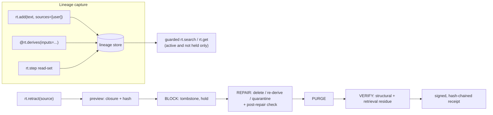

# Retract

Open-source Python SDK that records what agents derive from what. When a source must go, `retract(source)` finds every derived record across agents, tiers and stores, blocks them from reads, repairs them (delete / re-derive / quarantine) and issues a receipt with residue checks.

**Status:** pre-alpha research prototype (Nov–Dec 2026). The tests and the experiments in [docs/RESULTS.md](docs/RESULTS.md) are the only validation; there are no users yet. Design and decisions: [docs/PLAN.md](docs/PLAN.md).

## Why

A user's facts, or a document later found to be false, get copied into briefs, notes, plans and summaries across agents and stores. Deleting the originals leaves every derived copy. In our testbed, deleting a false policy document's own record left it in 30/30 trials and in 99.3% of answers. Retracting it with Retract left zero residue in 30/30 trials ([results](docs/RESULTS.md#61-residue)).

## How it works



Every write goes through the SDK. It records parent edges: declared `inputs=`, plus everything read inside the same `rt.step`. Retraction computes the closure of affected records and blocks it in one transaction, then repairs each record in topological order. The run is journaled, so a crash or a failed LLM call can be resumed with `rt.resume(op_id)`.

## Guarantees

| Level | MVP |
|---|---|
| L1 Hidden from Retract-guarded reads | Enforced + tested |
| L2 | Purged records are verified absent from supported adapter APIs. Quarantined records may remain physically accessible through the underlying store and are hidden only by Retract-controlled reads. |
| L3 | Not established. `retract audit` provides best-effort detection of potential SDK bypasses but cannot prove complete read/write coverage (dynamic dispatch, indirect clients, external services, uninstrumented access). |
| L4 Physically erased from vector index internals | **Not established** |
| L5 Removed from backups / external caches / model weights | **Not established** |

The post-repair check and the retrieval-residue probes are heuristics, not an oracle. They catch verbatim leaks of retracted text but missed every paraphrased leak in our experiments. A receipt's retrieval-residue `pass` therefore means no residue *the heuristic can see* ([results](docs/RESULTS.md#64-runtime-post-repair-check-under-injection)).

## Quickstart

Follow [Setup](#setup) first. Retract needs two keys in the environment: one for pseudonymous source references, one for signing receipts. Any random string works for a local trial:

```powershell
$env:RETRACT_PSEUDONYM_KEY = "dev-pseudonym"; $env:RETRACT_SIGNING_KEY = "dev-signing"
```

```bash
export RETRACT_PSEUDONYM_KEY=dev-pseudonym RETRACT_SIGNING_KEY=dev-signing
```

```python
from retract import Retract, src
from retract.adapters.simple import SimpleVectorStore

rt = Retract("lineage.db", stores={"private:support": SimpleVectorStore(), "shared": SimpleVectorStore()})


@rt.derives("weekly_summary", agent="support", tier="shared")
def summarize(inputs):
    return "Summary: " + " ".join(r.content for r in inputs)


priya = rt.add("Priya prefers WhatsApp.", sources=[src.user("u_priya")], agent="support", tier="private:support")
arjun = rt.add("Arjun's renewal is due in March.", sources=[src.user("u_arjun")], agent="support", tier="private:support")
summarize(inputs=[priya, arjun])

plan = rt.retract(src.user("u_priya"), dry_run=True)
print(plan.blast_radius)    # 2 records · 1 agents · 2 tiers
receipt = plan.execute()
print(receipt.outcome, receipt.receipt_type, receipt.verify().ok)  # completed retraction True
print([r.content for r in rt.search("renewal", tier="shared")])   # ["Summary: Arjun's renewal is due in March."]
```

Priya's record is deleted. The summary is re-derived from Arjun's record alone, and the old summary is purged from the store.

### Demo dashboard

```bash
make demo
```

Without make, run `uv run --extra dashboard python -m retract.cli demo` instead. Then open <http://127.0.0.1:8765>. The demo builds a small multi-agent world on an offline fake LLM, where a retraction of Mei failed mid-repair:

1. Try to retract `user:u_priya`. You are redirected to Mei's failed operation, which still holds records Priya's retraction needs.
2. Press **Resume**. The operation finishes `completed`, with a signed receipt and the three verification dimensions shown separately.
3. Retract Priya again: preview, then confirm.
4. Open any derived record and look at **Why does the agent know this?** for its lineage back to the owning sources.

The dashboard binds to 127.0.0.1 only. Every state change is a POST carrying a CSRF token.

## API

| Call | What it does |
|---|---|
| `Retract(db, stores={tier: adapter}, similarity_threshold=0.75)` | Lineage store plus one adapter per tier |
| `rt.add(text, sources=[...], agent=, tier=)` | Primary record owned by `sources` (`src.user`, `src.doc`, `src.conversation`, `src.tool`) |
| `@rt.derives(op, agent=, tier=, version="1", replayable=True)` | Registers a derivation. Calling it with `inputs=[...]` writes a derived record with parent edges. |
| `with rt.step(agent, tier):` | Guarded reads inside the step become parents of every write in it (deliberate over-approximation) |
| `rt.search(q, tier=, k=)`, `rt.get(id)` | Guarded reads: only `active` records that no operation holds |
| `rt.retract(source, mode="auto" \| "delete" \| "quarantine", dry_run=True)` | Plan: closure, actions, `blast_radius`, `closure_hash`. `plan.execute()` runs it and returns a receipt. |
| `rt.resume(op_id)` | Continues a failed or crashed operation from its journal |
| `receipt.verify()`, `rt.verify_chain()`, `receipt.export()` | Signature, chain link, execution and verification status; JSON export |
| `rt.orphan_scan()` | Reconciles crashes between the lineage write and the adapter write |
| `retract audit <path>` | Flags likely memory writes that bypass the SDK (exit 1). Allowlist in `[tool.retract.audit]`. |
| `retract demo` | The demo dashboard (extra `dashboard`) |

Adapters: `SimpleVectorStore` (in memory) and `Mem0Adapter` (extra `mem0`, local Qdrant). Others implement `retract.core.interfaces.MemoryAdapter`: `write`, `get`, `search`, `delete`, `find_by_token`, plus optional `list_ids`.

## Results at a glance

FakeLLM, 30 paired test seeds, two scenarios. Details, intervals and methods are in [docs/RESULTS.md](docs/RESULTS.md).

- **Residue:** every retraction mode left 0/30 structural and guarded retrieval residue (Wilson 95% upper bound 0.114). Naive delete left residue in 30/30.
- **What each mode keeps** (on the false-document scenario):
  - re-derivation kept 99.2% of records and all honest fact mentions;
  - delete and quarantine kept 58.1% of records and 11.5% of honest mentions.
- **Negative results:**
  - Paraphrased leaks evade the runtime check at every threshold tried.
  - Re-derivation is not the counterfactual clean world: it has 54.5 fewer honest mentions than a world that never saw the bad document.
  - On the false-document scenario, quarantine leaves 44% of guarded reads short of k.
- **Cost:**
  - a Retract write is about 55× a raw adapter write (durable SQLite commits);
  - a guarded read is about 1.9× a raw read;
  - a 54-record retraction takes 1.9 s plus LLM latency.
- **Hosted LLM** (Groq `openai/gpt-oss-120b`): in progress.

## Limits

- **Coverage:** only reads and writes through the SDK are tracked and guarded (L3). Anything else is invisible.
- **Physical erasure** is not established (L4/L5). Quarantined content stays in its store by design.
- **The runtime check is a heuristic** (sentence match plus a hashed bag-of-words embedding). It misses paraphrases.
- **Re-derivation** replays old inputs minus the retracted ones. It does not re-run retrieval, so repaired memory can differ from a clean history.
- **Concurrency:** one retraction executes at a time (a durable lease lock).
- **Receipts:** anyone with database write access *and* the signing key can rewrite history.
- **Status:** pre-alpha; APIs may change.

## Roadmap

- A semantic embedder for the runtime check, re-tuned on dev seeds.
- Hosted-LLM results with more seeds and a second model.
- More adapters: managed vector stores and LangGraph store integration.
- Per-closure locks for parallel retractions.
- Cross-module dataflow in `retract audit`.
- Erasure work beyond L2: vector-index internals.

## Hypotheses (untested)

These motivate the project but nothing here validates them:

- Teams will route all agent-memory reads and writes through an SDK.
- Privacy and compliance teams will accept signed receipts plus residue checks as deletion evidence.
- Source-level retraction is worth a product rather than a feature memory vendors add.

## Setup

Requires Python 3.11+ and git.

1. Install uv:

   ```bash
   pip install --user uv
   ```

2. Put uv on PATH. `pip --user` installs it to the user scripts directory, which is often not on PATH.

   - Windows (PowerShell), for Python 3.12:

     ```powershell
     $scripts = "$env:APPDATA\Python\Python312\Scripts"
     [Environment]::SetEnvironmentVariable("Path", [Environment]::GetEnvironmentVariable("Path", "User") + ";$scripts", "User")
     ```

     Open a new terminal afterwards. For another Python version, use the `Scripts` folder under `python -m site --user-base`.

   - Linux / macOS: add `$(python3 -m site --user-base)/bin` to `PATH`.

   Check with `uv --version`.

3. Optionally install make. On Windows, run `choco install make`; on Linux and macOS it is usually preinstalled. Every make target is a single `uv run ...` command, listed in the [Makefile](Makefile), that you can also run directly.

4. Install dependencies and run the tests:

   ```bash
   uv sync
   make test
   ```

Optional extras: `llm`, `embed`, `mem0`, `testbed`, `dashboard` (for example `uv sync --extra mem0`). The make targets install the extras they need.

| Target | What it runs |
|---|---|
| `make test` | The test suite |
| `make demo` | The demo dashboard |
| `make experiments` | FakeLLM experiments and the cost benchmark (about 4 min) |
| `make experiments-groq` | Hosted-LLM experiments (needs `GROQ_API_KEY`) |
| `make experiments-groq-replay` | The same results from the committed response cache, with no key |

## Secrets

Retract reads keys only from the process environment. Nothing parses a `.env` file. See [.env.example](.env.example) for the variable names. Keys are never logged or written to receipts.

## License

[Apache-2.0](LICENSE)
