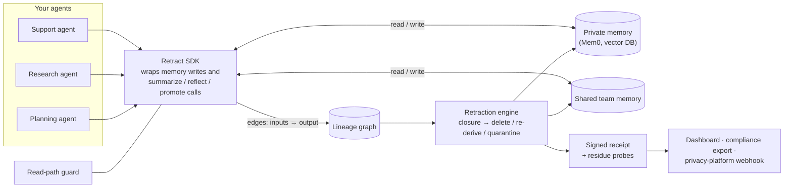

# Retract: the undo button for AI agent memory

**Project brief · capstone + startup plan**
Author: Khushi Chhabra · Version 1 · 8 November 2026
"Retract" is a working name. Check trademark and domain availability before using it publicly.

---

## TL;DR

AI agents now keep long-term memory. They summarize conversations, extract facts, write reflections, and promote knowledge into memory shared with other agents. When a company has to remove a source (a user who asks for deletion, a customer who churns, a poisoned document, a revoked data connector), deleting the original record is not enough. **Everything the agents derived from it stays behind.**

**Retract** tracks what every agent derived from what, across memory stores and across agents. With one call, `retract(source)`, it finds every derived record. It then deletes or regenerates each one, blocks it from retrieval in the meantime, and issues a signed receipt plus a test proving nothing was left behind.

- **One engine, three budgets:** privacy (erasure requests under GDPR and India's DPDP Act), security (recovery from memory poisoning), and B2B platforms (purging a churned customer's data from agent memory).
- **Capstone value:** it directly addresses open challenges 3, 4, 5 and 9 in your survey ("Security of LLM-Based Agents…", v4, Section 14.1).
- **Rating:** **8.1/10 as a capstone, 6.7/10 as a startup (unproven).** The capstone de-risks the startup at almost no extra cost. See Section 8.

---

## 1. The problem

### 1.1 What goes wrong (a concrete scenario)

A B2B SaaS company runs three agents: a support agent, an account-research agent, and a planning agent. All three use Mem0-style long-term memory, plus a shared "team knowledge" tier.

1. A customer contact, Priya, chats with the support agent. Her messages are stored as raw memory.
2. The support agent extracts facts ("Priya prefers WhatsApp", "Priya's company is migrating to AWS in Q2") and writes a weekly summary into the shared tier.
3. The planning agent reads that summary and writes its own derived notes into its private memory.
4. Priya asks for her data to be deleted. Engineering deletes her raw conversation and her user namespace.
5. **Her facts survive** inside the shared weekly summary and the planning agent's notes. Nobody can list where they went, so nobody can prove deletion.

Now swap Priya for a **poisoned document** that slipped into memory. It is the same problem with a security owner: you need to find and repair everything it influenced, across agents.

### 1.2 Evidence that this is real

- Microsoft's architecture guidance for production agents says that deleting a conversation does not delete the summaries, embeddings, profiles, caches or derived memories built from it. It calls partial deletion a compliance risk and says derived data needs lineage identifiers [1].
- Regulators are naming memory explicitly. Spain's data protection authority (AEPD) issued agentic-AI guidance in early 2026 that treats every memory layer, from context windows to long-term stores, as subject to data-subject rights including erasure [2]. On 18 February 2026 the European Data Protection Board published the results of a year-long coordinated action on the right to erasure [3].
- Memory vendors leave the hard part to the application. Researchers note that Mem0 delegates deletion and audit consistency to the application [4]. Zep goes further: it links derived facts to source "episodes" and deletes a fact only when no other episode supports it. But its documentation states that deleting an episode **does not regenerate the names or summaries** of nodes shared with other episodes [5][6].
- Physical deletion is also unreliable. A June 2026 paper, *Ghost Vectors*, reports that soft-deleted embeddings can remain reconstructible in HNSW vector databases [3].
- Teams are hand-building fixes. One SaaS backend added lineage tags so it can purge agent memories learned from a disconnected connector [7]. An open-source agent-memory project has an open P0 issue about vector residue left after "permanent forgetting" [8].
- Awareness is low. Atlan writes that GDPR's right to erasure applies to agent memory and that most enterprise teams haven't mapped this gap yet [9].
- The security side is documented too. OWASP lists memory and context poisoning as ASI06 in its Top 10 for Agentic Applications [10]. Your survey's Section 10.4 and open challenge 5 show that recovery work so far covers single stores (RAGForensics, MemSecBench), not records derived or promoted across agents.

### 1.3 Why existing tools don't solve it

| Tool type | What it does | Why the problem remains |
|---|---|---|
| Memory stores (Mem0, Zep, Letta, Cloudflare, AWS AgentCore Memory) | Store and retrieve memory; Zep tracks episode provenance | Each works inside one store. Zep doesn't regenerate shared summaries. Nobody tracks derivations that cross stores or agents. |
| Privacy request platforms (OneTrust, Transcend) | Intake, orchestration and proof of completion across connected systems [11][12] | They orchestrate deletion across the systems they connect to. Reaching derived agent memory requires a connector that understands derivation. |
| Runtime memory guards (e.g., OWASP Agent Memory Guard) | Inspect and filter what enters and exits memory [13] | Prevention and detection, not undo after the fact. |
| Agent observability and governance (Atlan, Waxell, Fiddler) | Inventory, policies, tracing | They trace activity but don't run a retraction engine over derived memory. |

---

## 2. The solution

### 2.1 One primitive: `retract(source)`

A **source** is anything that can taint memory: a user, a conversation, a document, a connector, a tool, an agent or a tenant.

`retract(source)` does five things:

1. **Find:** compute everything derived from the source, transitively, across stores and agents (the "blast radius").
2. **Block:** immediately hide those records from retrieval (read-path revocation).
3. **Repair:** for each derived record, choose one of:
   - **delete:** remove it if no other valid source supports it (Zep's support-set rule, generalized across stores);
   - **re-derive:** regenerate it from the remaining valid inputs (e.g., rewrite the weekly summary without Priya);
   - **quarantine:** keep it hidden pending human review (for security incidents).
4. **Tombstone:** stop late background jobs from recreating what was removed.
5. **Prove:** issue a signed, hash-chained receipt, then run **residue probes** (queries and direct store checks) that confirm the retracted content can no longer be retrieved.

### 2.2 Architecture



**Key design choice:** lineage is captured **at write time, by the harness, not by the model**. Every record carries the set of sources whose content was in the writing agent's context, and derived records inherit the union of their inputs' sources. This is the same label-inheritance idea as your survey's Section 12.2 and open challenge 3, used here for deletion as well as for security.

### 2.3 Developer experience (illustrative API)

```python
from retract import Retract, src

rt = Retract(store="mem0", lineage_db="postgresql://localhost/retract")

# 1. Writes carry their sources and legal basis
rt.add(
    "Prefers WhatsApp for follow-ups",
    agent="support",
    sources=[src.user("u_priya"), src.conversation("c_881")],
    basis="consent:cm_42",
)

# 2. Derivations inherit sources automatically
@rt.derives(agent="support", tier="shared")
def weekly_summary(records):
    return llm.summarize(records)

# 3. Preview, then retract everything derived from a user
plan = rt.retract(src.user("u_priya"), mode="rederive", dry_run=True)
print(plan.blast_radius)   # e.g. 14 records · 3 agents · 2 shared summaries

receipt = plan.execute()
receipt.verify()           # residue probes + signature check
receipt.export("dpdp")     # evidence pack for the privacy team
```

---

## 3. Features

### 3.1 MVP (built in the 1-month capstone)

| # | Feature | What it does | Done when |
|---|---|---|---|
| 1 | Lineage capture SDK | Wraps memory writes and LLM derivation calls (Mem0 OSS + LangGraph store) | Every write in the testbed has source labels |
| 2 | Label inheritance | Derived and promoted records inherit their inputs' sources | A summary of three users' chats carries all three labels |
| 3 | Read-path guard | Retracted, quarantined and tombstoned records are never returned | 0 retracted records retrieved across all probe queries |
| 4 | Blast-radius preview | Dry run lists every affected record, agent and tier | Preview matches the ground truth of the testbed |
| 5 | Retraction engine | Delete / re-derive / quarantine per record | Works across private and shared tiers |
| 6 | Signed receipts | Hash-chained, HMAC-signed record of every action | Tampering with a receipt fails verification |
| 7 | Residue probes | Semantic probe queries plus direct store checks | Residue rate reported per retraction |
| 8 | Lineage coverage check (CI) | AST scan that flags memory writes bypassing the SDK; built on your CodeLens analyzer | CI fails on an unlabeled writer |
| 9 | Dashboard | Lineage explorer, "why does the agent know this?", retraction queue, receipts | Live demo of the Priya scenario end to end |

### 3.2 Version 1 (months 2–6)

- **More integrations:** import Zep/Graphiti episode associations; Letta, LlamaIndex, CrewAI, OpenAI Agents SDK; pgvector, Qdrant, Pinecone; LangGraph checkpoints.
- **Privacy-platform connectors:** a webhook connector so OneTrust/Transcend DSR workflows can call Retract, plus consent-withdrawal hooks for DPDP consent flows.
- **Incident mode:** quarantine a poisoned source fleet-wide, show affected decisions, then roll back.
- **Policy engine:** retention limits, purpose limitation, per-tenant isolation checks.
- **Physical deletion verification:** index-level residue checks for vector stores (the Ghost Vectors problem) and an optional crypto-shredding mode, with a per-source key so deleting the key makes backups unreadable (as in MemTrust [14]).
- **Evidence packs:** GDPR Art. 17 and DPDP erasure logs; AIUC-1 data & privacy evidence.
- **Enterprise basics:** self-host/VPC deployment, SSO, RBAC, audit log export.

### 3.3 Later and moonshot

- **Memory blame:** trace any agent decision back to the sources that shaped it, for auditors, insurers and incident response.
- **Consent-aware memory:** a user withdraws consent once, and every agent forgets.
- **Open lineage format:** a vendor-neutral spec that memory stores adopt, making Retract the standard rather than a feature.
- **Certified containment:** the partition-and-vote design from your survey's Section 12.2, running on the same labels. This gives a provable bound on how far a compromised source can influence other agents.
- **Licensed, revocable knowledge exchange** between different companies' agents, with provenance and revocation built in.

---

## 4. USP: what makes it stand out

1. **It deletes what agents learned, not just what you stored.** Every other tool deletes the source record. Retract also finds what agents derived from it.
2. **Re-derive, don't destroy.** Naively deleting every derived artifact also destroys knowledge other sources still support [4]. Retract regenerates summaries without the removed input, which Zep explicitly does not do on episode deletion [6].
3. **Cross-store, cross-agent, vendor-neutral.** Memory vendors can only see their own store. Retract follows a derivation from Mem0 into a shared summary into another agent's notes.
4. **Proof, not promises.** Signed receipts and residue probes give privacy teams evidence they can show regulators and auditors.
5. **Blast-radius preview.** You see exactly what will change before you delete anything.
6. **One engine, three budgets.** Privacy, security and customer offboarding all buy the same core.
7. **Lineage coverage in CI.** Static analysis catches code that writes memory without lineage. This comes straight from your CodeLens experience, and competitors focused on runtime won't have it.
8. **Research-grade credibility.** It is built by the author of a source-verified survey on agent memory security, with an open benchmark and published metrics.
9. **Partner, not rival, to privacy platforms.** Retract is the connector that lets OneTrust/Transcend workflows reach derived agent memory.

**Positioning statement.** For teams shipping AI agents with long-term memory, Retract is the lineage and retraction layer that removes everything agents derived from a source and proves it. Memory stores only delete within their own store, and privacy platforms can't see derived agent memory. Retract tracks derivations across agents and stores, regenerates what is still valid, and issues verifiable receipts.

**What Retract is not:** a memory store, a prompt-injection filter, or a DSR intake portal.

---

## 5. Why it can be a great business

### 5.1 Why now

| Driver | Evidence |
|---|---|
| Memory became infrastructure in 2026 | Mem0 reports 100,000+ developers and has raised $24M [15]; Mem0, Zep, Letta, Cloudflare and AWS all ship memory layers |
| Regulators named memory layers | AEPD agentic-AI guidance (early 2026) [2]; EDPB erasure coordinated action (Feb 2026) [3] |
| India's DPDP deadline | Core obligations apply from **13 May 2027** [16]. Penalties go up to ₹250 crore for failing to maintain reasonable security safeguards [17] |
| Certification and insurance | AIUC-1 ("SOC 2 for AI agents") has a data & privacy pillar covering cross-customer exposure and PII leakage [18]. Certification unlocks coverage up to $50M, and Drata now supports the framework [19]. Intercom's Fin and UiPath are certified [20] |
| Money is flowing into AI security | Gartner sizes "securing AI" at about $2.8B in 2026 and $4.8B in 2027 [21]. CrowdStrike is buying Fiddler AI (~$400M) and Dreadnode (~$95M) [22]. General agent-security startups are crowding the market [28], which is why Retract targets a narrower gap |

### 5.2 Buyers and use cases

| Buyer | Trigger | What they get | Budget owner |
|---|---|---|---|
| Privacy / legal (DPO) | Erasure request, DPDP deadline, regulator inquiry | Erasure that reaches derived memory, plus evidence | DPO / General Counsel |
| Security (AppSec / IR) | Memory poisoning incident; an ASI06 control in a security review | Fleet-wide quarantine and rollback | CISO |
| B2B platform engineering | Customer churn, connector disconnect, enterprise security questionnaires, AIUC-1 | Tenant offboarding purge plus certification evidence | CTO / VP Engineering |
| Memory vendors and agent platforms (partners) | Their customers ask for compliance | Embed or resell Retract | Business development |

**Ideal first customer:** a startup or mid-size company whose agents write **shared, derived or multi-agent memory** that holds personal data. Apps with strictly per-user namespaces and no shared or derived memory can already delete by user ID, so they don't need Retract.

### 5.3 Market size

- **Top-down context:** Retract sits inside the "securing AI" budget (~$2.8B in 2026 → ~$4.8B in 2027 [21]) and the privacy-operations budget, where OneTrust and Transcend compete. The standalone "agent memory governance" category is new and small today.
- **Bottom-up (illustrative, not a forecast):**
  - 1,000 teams paying ~$200/month ≈ **$2.4M ARR**
  - 100 enterprises paying ~$30k/year ≈ **$3M ARR**

  The real numbers come from discovery calls (Section 9). Treat these as targets to test.

### 5.4 Business model and pricing hypotheses

- **Open-core:** Apache-2.0 SDK (lineage capture, read guard, local retraction) to win developer adoption.
- **Paid cloud:** hosted lineage graph, retraction workflows with approvals, receipts and verification, compliance exports, dashboard, connectors.
- **Starting price hypotheses (to test with design partners, not market data):**
  - Free: self-hosted SDK
  - Team: ~$99–199/month
  - Business: ~$499–999/month (connectors, evidence packs, SSO)
  - Enterprise: annual contract, self-host or VPC
- **Anchor:** what teams already spend on memory. Mem0 runs from free to $249/month, and Zep's Flex plan is $125/month [23]. For Indian customers, price in INR.

### 5.5 Go-to-market

| Phase | When | Focus |
|---|---|---|
| 0: Build and validate | Nov–Dec 2026 | Capstone build, open-source release, 20 discovery calls, 3 design partners, arXiv paper |
| 1: DPDP push (India) | Jan–May 2027 | "DPDP for AI agents" guide and checklist; partner with privacy law firms and DPDP consultants; Indian SaaS, fintech and healthtech pilots before 13 May 2027 |
| 2: Ecosystem | Mid-2027 | Listed integrations in the Mem0/LangChain ecosystems, a Zep importer, privacy-platform connectors, AIUC-1 evidence; EU-facing startups |
| 3: Enterprise | Late 2027+ | Self-host, incident mode, security buyers; raise pre-seed once 3+ paid pilots exist |

**Channels:** open source and technical content (your benchmark results), community talks, partnerships with privacy consultants and compliance-automation platforms, memory-vendor partner programs.

### 5.6 Moat (honest version)

- **Write-path position:** lineage must be captured when data is written and cannot be reconstructed later, so switching costs grow with every month of history.
- **Verification depth:** re-derivation correctness, residue testing and adaptive evaluation are research-heavy and slow to copy.
- **Neutrality:** a memory vendor can't credibly track lineage through a competitor's store; Retract can.
- **Standard and benchmark ownership:** publish the lineage format and the evaluation benchmark.
- **Caveat:** early moats are thin. Speed, integrations and partnerships matter more than technology in year one.

### 5.7 Competition

| Category | Examples | Strength | Gap Retract fills | Threat | Partner potential |
|---|---|---|---|---|---|
| Memory layers | Mem0, Zep/Graphiti, Letta, Cloudflare, AWS AgentCore Memory | Own the store; Zep has episode provenance [5] | Single-store; no regeneration of shared summaries; no cross-agent receipts | **High** (could build natively) | High (plugin/OEM) |
| Privacy platforms | OneTrust, Transcend | DSR orchestration, proof of completion, buyer relationships [11][12] | Need a connector that understands derived agent memory | Medium | **High** (channel) |
| AI governance / observability | Atlan, Waxell, Fiddler (→ CrowdStrike) | Inventory, policy, tracing | No retraction engine | Medium | Medium |
| Runtime memory guards | OWASP Agent Memory Guard, AI-security vendors | Prevention and detection [13] | No undo after the fact | Low–medium | Medium |
| Data security / DSPM | Cyera, Varonis (Proofpoint) | Sensitive-data discovery, big budgets | Not derivation-aware for agent memory | Medium (long term) | Acquirer |
| Research / open source | SuperLocalMemory 4.0 [24], MemLineage, MAP-Graph, Agentic Unlearning [4], dependency-guided rollback repair [25] | Ideas and prototypes | Not cross-vendor products | Low | Cite and build on |

### 5.8 Exit and strategic value

Data security is where the large deals are happening. Proofpoint agreed to buy Varonis for $6.3B (Oct 2026) [26], and Cyera, an AI data security company, raised $400M at a $9B valuation (Jan 2026) [27]. Natural acquirers include data-security platforms, privacy platforms, security platforms building agent coverage, and memory vendors.

---

## 6. The capstone (research side)

### 6.1 Link to your survey (v4, Section 14.1)

| Open challenge | Where it appears in Retract |
|---|---|
| 3. Provenance that survives transformation | Label inheritance through summaries, reflections, promotion |
| 4. Read-path revocation | Read-path guard, on by default |
| 5. Recovery after poisoning across agents and derived records | Retraction engine (delete / re-derive / quarantine) |
| 6. Honest cost accounting | Token, latency and storage multiples reported per retraction |
| 8. Confidentiality of shared memory | Per-principal views (V1) |
| 9. Benchmarks that isolate the memory channel | The multi-agent testbed |
| 1. Containment bounds for shared memory | Certified containment (follow-on paper) |

### 6.2 Research questions

- **RQ1 (privacy):** How much residue remains after naive deletion versus lineage-based retraction, across private, shared and promoted tiers?
- **RQ2 (security):** After a poisoned source is retracted, does attack success at each stage (injection, retrieval, action) return to the clean baseline? How much honest knowledge does delete lose compared with re-derive?
- **RQ3 (cost):** What does retraction cost in tokens, latency and storage, as multiples of the undefended baseline?
- **RQ4 (your Section 11.4 hypotheses):** Do monitors that read only messages miss spread through derived or promoted memory? Does voting without provenance labels fail under memory contagion?

### 6.3 Testbed

- A 3–4 agent LangGraph pipeline. Each agent has private memory (Mem0 OSS); a shared tier receives promoted summaries. The message channel and the memory channel are instrumented separately.
- **Synthetic** personas and documents only, with no real personal data.
- For the security experiments, **reuse published attack setups from your survey's Table 2**, with released code where available, in a sandbox. Don't write new attacks.
- Models: Groq-hosted Llama 3.3 (cheap and fast) plus one more model to check the results generalize.

### 6.4 Metrics (from your survey's Section 6)

- **Residue rate:** share of probe queries that still surface retracted content.
- **Stage-specific attack success** after retraction.
- **Over-deletion rate:** honest records lost.
- **Utility:** task accuracy before and after retraction.
- **Cost:** tokens and latency as multiples of baseline.
- **Statistics:** report trial counts and Clopper–Pearson or Wilson intervals for every figure.

### 6.5 Closest prior work and your contribution

- Dependency-guided rollback repair traces contamination through dependency graphs and selectively replays affected steps [25].
- Agentic Unlearning enforces dependency-consistent deletion in memory [4].
- SuperLocalMemory 4.0 issues verified erasure receipts across stores [24].
- Zep deletes facts by support set within its own graph [5][6].

**Your contribution:** retraction **across agents through promoted shared memory**, measured for **both privacy and poisoning**, comparing delete with re-derive and including residue verification. From what I read, none of the works above covers that combination. Confirm this during your write-up.

### 6.6 Deliverables

1. Open-source repository (SDK, testbed, benchmark scripts)
2. Dashboard demo plus a 3-minute video of the Priya scenario
3. Short paper (arXiv; target a workshop)
4. Benchmark results table using your survey's metrics
5. Discovery-call notes and design-partner letters (business evidence)

### 6.7 Ethics

Use synthetic data only, and run attack setups only from published papers, inside a sandbox. If you find residue bugs in a real memory product, disclose them privately to the vendor before publishing.

---

## 7. One-month plan (9 Nov – 6 Dec 2026)

| Week | Build | Research | Business |
|---|---|---|---|
| **1** (Nov 9–15) | SDK core: lineage capture on Mem0 + LangGraph, label inheritance, read guard, SQLite lineage tables | Testbed with private + shared tiers; synthetic personas | Write discovery script; book 10 calls |
| **2** (Nov 16–22) | `retract()` with delete / re-derive / quarantine, tombstones, signed receipts, residue probes | Naive-deletion baseline measurements | 10 calls done; shortlist design partners |
| **3** (Nov 23–29) | Blast-radius preview; lineage coverage CI check (CodeLens) | RQ1–RQ4 experiments with intervals | 10 more calls; ask 3 teams for a pilot |
| **4** (Nov 30–Dec 6) | FastAPI dashboard, docs, open-source release | Paper draft, results tables | Landing page, demo video, pilot letters |

**Scope guard:** if week 2 slips, cut re-derive down to summaries only and drop the CI check. Keep the receipts and residue probes, because they are what makes the project stand out.

---

## 8. Analysis and rating

### 8.1 As a capstone / resume project: **8.1 / 10**

| Criterion | Weight | Score | Why |
|---|---|---|---|
| Research novelty | 20% | 8 | Cross-agent retraction with re-derivation and residue checks isn't covered by prior work found; lineage alone isn't new |
| Fit with your survey | 15% | 10 | Directly implements open challenges 3, 4, 5, 9 |
| Feasibility in 1 month | 20% | 7 | MVP is doable; re-derivation plus experiments is tight |
| Technical depth | 15% | 8 | Graph lineage, verification, multi-agent evaluation |
| Resume / interview impact | 15% | 9 | Survey author + shipped OSS tool + demo + paper |
| Publishability | 15% | 7 | Workshop or arXiv likely; a main venue needs adaptive evaluation at scale |
| **Weighted total** | | **8.1** | |

### 8.2 As a startup: **6.7 / 10** (promising, unproven)

| Criterion | Weight | Score | Why |
|---|---|---|---|
| Problem severity | 15% | 7 | Legally required and documented, but many teams don't know they have it yet |
| Timing | 15% | 9 | Memory became infrastructure; DPDP 2027; AEPD/EDPB; AIUC-1 |
| Market size | 10% | 6 | Niche today; grows with shared and multi-agent memory |
| Differentiation | 15% | 7 | Cross-store re-derivation plus receipts is distinct; lineage itself isn't |
| Defensibility | 15% | 5 | Zep already has single-store provenance; memory vendors or privacy platforms could extend |
| Go-to-market ease | 10% | 5 | Compliance buyers are slow; developer-led adoption and partners help |
| Monetization clarity | 10% | 6 | Budget owners exist, but willingness to pay is unvalidated |
| Founder fit | 10% | 8 | Survey author, static analysis and CI background, FastAPI |
| **Weighted total** | | **6.7** | |

**Verdict:** an excellent capstone and a credible but unproven business. The biggest swing factor is whether discovery calls show teams will pay **before** enforcement or an incident forces them to. The capstone answers that question at almost no extra cost, so doing both together is the right move.

### 8.3 SWOT

| Strengths | Weaknesses |
|---|---|
| Deep domain knowledge (your survey); one engine serves three buyers; matches your skills; open-source wedge | Solo student founder; no customers yet; re-derivation is technically hard; enterprise sales are slow |
| **Opportunities** | **Threats** |
| DPDP 2027 deadline; AEPD/EDPB attention; AIUC-1 evidence demand; privacy-platform partnerships; memory-vendor OEM deals | Zep/Mem0 build it natively; OneTrust/Transcend extend downward; DSPM vendors extend into agent memory; weak enforcement delays buying |

### 8.4 Risks and mitigations

| Risk | Likelihood | Mitigation |
|---|---|---|
| Memory vendors add cross-store lineage | Medium | Be vendor-neutral and multi-agent; offer to partner or OEM; focus on receipts and verification |
| Simple apps don't need it (per-user namespaces) | High for simple apps | Target shared, derived and multi-agent memory only |
| Re-derivation is costly or unstable | Medium | Default to delete-if-unsupported; re-derive only shared summaries; cache; measure cost honestly |
| Legal ambiguity about what counts as erasure | Medium | Provide evidence and options; work with privacy lawyers; don't make legal claims |
| Long enterprise sales cycles | High | Start with startups and DPDP-bound Indian teams; partner channels |
| Physical residue in vector indexes | Medium | Index-level checks; crypto-shredding option |

### 8.5 Kill and pivot criteria

- **After 20 calls, fewer than 5 teams report derived or shared memory plus deletion pain:** pivot to security-only (poisoning recovery) or to a plugin for one memory vendor.
- **No design partner integrates within 60 days:** keep it as open source and research, and revisit when DPDP enforcement starts.
- **A major memory vendor ships cross-store re-derivation:** pivot to the independent verification and receipts layer that auditors and insurers use.

### 8.6 Validation milestones

| By | Milestone |
|---|---|
| 30 days | MVP + open-source release; 20 discovery calls; 3 design partners; arXiv draft |
| 90 days | Running in production at 2 design partners; first paid pilot; Zep importer |
| 180 days | 5 paying customers; one privacy-platform connector; pre-seed conversations |

---

## 9. Customer discovery kit

**Who to talk to:** founders and engineers at startups shipping agents with memory (YC and Indian SaaS communities, LangChain/Mem0/Zep communities), DPOs at Indian fintech and healthtech companies, and privacy consultants.

**Questions:**
1. Do your agents keep memory across sessions? Where is it stored?
2. Do agents write summaries or facts derived from user data? Into which stores? Is any of it shared across users or agents?
3. Walk me through the last time a user asked for deletion. What happened to the derived data?
4. How do you prove deletion to a customer, auditor or regulator?
5. Have enterprise security questionnaires asked about AI memory retention or deletion?
6. If a poisoned document got into memory, how would you find everything it affected?
7. Who would own this budget, and what is solving it worth to you?

**Strong signals:** they hand-built something, a questionnaire asked about it, they had a deletion request in the last 90 days, or they have a DPDP project underway.
**Red flags:** no persistent memory, or strictly per-user memory with nothing derived or shared.

---

## 10. Tech stack

- **Core:** Python 3.11, Pydantic, FastAPI
- **Lineage store:** SQLite → Postgres (recursive CTEs), NetworkX for analysis
- **Integrations:** Mem0 OSS, LangGraph (then Zep, Letta, LlamaIndex)
- **Models:** Groq-hosted Llama 3.3 for derivation and evaluation
- **Receipts:** HMAC-SHA256, hash-chained, append-only
- **Quality:** pytest, GitHub Actions, Docker, CodeLens AST analyzer for the lineage coverage check
- **Dashboard:** FastAPI + HTMX or Streamlit for speed

---

## References

1. Microsoft Tech Community, "Remember, Retrieve, Revalidate—or Forget? Architecting Memory for Production AI Agents." https://techcommunity.microsoft.com/blog/azure-ai-foundry-blog/remember-retrieve-revalidate-or-forget-architecting-memory-for-production-ai-age/4564392
2. TianPan, "GDPR's Deletion Problem: Why Your LLM Memory Store Is a Legal Liability" (summarizes AEPD agentic-AI guidance). https://tianpan.co/blog/2026/04/20/gdpr-llm-memory-erasure-vector-database
3. Waxell, "AI agent data deletion and the embedding layer" (EDPB coordinated action; Ghost Vectors, arXiv:2606.18497). https://waxell.ai/blog/ai-agent-data-deletion-embedding-layer
4. "Agentic Unlearning: When LLM Agent Meets Machine Unlearning," arXiv:2602.17692. https://arxiv.org/pdf/2602.17692
5. Zep docs, "Episode metadata projection." https://help.getzep.com/episode-metadata-projection
6. Zep docs, "Deleting Data from the Graph." https://help.getzep.com/deleting-data-from-the-graph.mdx
7. Gravitre backend PR #374, "Memory lineage: purge agent memories learned from a disconnected source." https://github.com/cesarbohjr/gravitre-saas-backend/pull/374
8. MythologIQ agent-memory issue #802, "Prevent persisted semantic-vector residue after permanent forgetting." https://github.com/MythologIQ-Labs-LLC/agent-memory/issues/802
9. Atlan, "Data Privacy for AI Agents: GDPR, CCPA and EU AI Act Compliance." https://atlan.com/know/data-privacy-for-ai-agents/
10. MintMCP, "AI agent memory poisoning" (OWASP ASI06). https://www.mintmcp.com/blog/ai-agent-memory-poisoning
11. Transcend, privacy and legal solutions. https://transcend.io/solutions/by-team/privacy-legal-risk
12. B. D. Emerson, "OneTrust vs Transcend" (Nov 2026). https://www.bdemerson.com/article/onetrust-vs-transcend
13. Kiteworks, "OWASP Agent Memory Guard." https://www.kiteworks.com/cybersecurity-risk-management/owasp-agent-memory-poisoning-guard/
14. "MemTrust: A Zero-Trust Architecture for Unified AI Memory System," arXiv:2601.07004. https://arxiv.org/pdf/2601.07004
15. Preuve, "AI memory systems statistics 2026" (citing Mem0's State of AI Agent Memory 2026). https://preuve.ai/blog/ai-memory-systems-statistics-2026
16. Khaitan & Co (Mondaq), "Digital Personal Data Protection Rules 2025 – Highlights." https://www.mondaq.com/india/privacy-protection/1707558/digital-personal-data-protection-rules-2025-highlights
17. PIB, "DPDP Rules, 2025 Notified." https://static.pib.gov.in/WriteReadData/specificdocs/documents/2025/nov/doc20251117695301.pdf
18. ElevenLabs, "What is AIUC-1." https://elevenlabs.io/blog/what-is-aiuc-1
19. SafeBase/Drata, "Drata Now Supports AIUC-1." https://www.safebase.io/blog/introducing-aiuc-1
20. NYU Shanghai RITS, "AIUC-1, the AI Agent Certification, Turns to Coding Agents." https://rits.shanghai.nyu.edu/ai/aiuc-1-the-ai-agent-certification-turns-to-coding-agents/
21. AgentBeam, "AI Agent Security Market 2026: Gartner & Funding." https://agentbeam.com/blog/ai-agent-security-market-2026
22. TechCrunch, "CrowdStrike to shell out nearly $500M for 2 AI security startups" (3 Nov 2026). https://techcrunch.com/2026/11/03/crowdstrike-to-shell-out-nearly-500m-for-2-ai-security-startups-as-the-market-for-securing-agents-takes-off/
23. eCorpIT, "AI agent memory in 2026: Mem0 vs Zep vs Letta vs Cloudflare." https://ecorpit.com/ai-agent-memory-mem0-zep-letta-cloudflare-comparison-2026/
24. "SuperLocalMemory 4.0: The Governed Memory Operating System for AI Agents," arXiv:2608.08253. https://arxiv.org/pdf/2608.08253
25. "From Faulty Memories to Corrected Actions: Dependency-Guided Rollback Repair for Memory-Augmented Agents," arXiv:2608.10502. https://arxiv.org/pdf/2608.10502
26. The Flywheel, "AI Agent Security Vendors 2026" (Proofpoint–Varonis). https://wetheflywheel.com/en/guides/ai-agent-security-vendors-2026/
27. Software Strategies Blog, "Agentic AI security startups, funding and M&A" (Cyera). https://softwarestrategiesblog.com/2026/03/28/agentic-ai-security-startups-funding-mna-rsac-2026/
28. TechCrunch, "Reco raises $55M as AI agent security startups crowd the market." https://techcrunch.com/2026/09/29/reco-raises-55m-as-ai-agent-security-startups-crowd-the-market/
29. K. Chhabra, "Security of LLM-Based Agents Regarding Attacks, Defenses, Persistent Memory, and Multi-Agent Contagion: A Survey," draft v4 (Nov 2026), Sections 6, 10–14.
